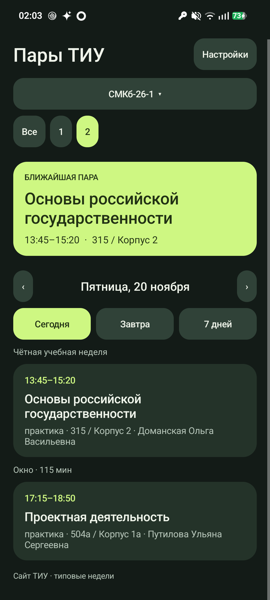
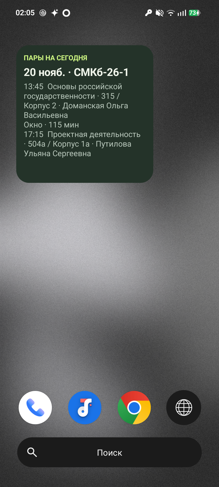

# Пары ТИУ для Android

Независимое приложение для расписания групп Тюменского индустриального университета. Поддерживает Android 13 и новее.

- Поиск группы по названию и переключатель подгрупп над расписанием. «Моя подгруппа» в настройках задаёт фильтр для уведомлений.
- Избранные группы доступны под выбором группы. Просмотр другой группы сохраняет личное расписание для виджетов и напоминаний.
- Расписание по дням, лента на семь дней и офлайн-копия.
- Длительность окон между занятиями в минутах.
- Автоматический переход на завтра через два часа после последней пары.
- Пять виджетов, напоминания перед занятиями и будильник к первой паре через системное приложение «Часы».
- Темы с предпросмотром, включая монохром с точечным шрифтом, «Бумагу», «Океан» и «Сливу».
- «Важные ссылки» открывают Эдукон, «Мой ТИУ», официальное расписание и электронную библиотеку в браузере.

Готовый APK доступен в [Releases](https://github.com/0x91m0n/tyuiu-rasp-android/releases).

## Скриншоты

| Расписание | Виджет на главном экране |
| :---: | :---: |
|  |  |

## Данные и сеть

Группа, настройки и копия расписания хранятся на устройстве. Сетевые загрузки идут по HTTPS на официальный сервер расписания ТИУ или по URL каталога, заданному в настройках. Напоминания и обновления виджетов выполняются средствами Android. Открытая сборка обходится без SDK аналитики, рекламы и отчётов о сбоях. [Расписание ТИУ](https://timetable.tyuiu.ru/)

Приложение планирует обновление личной группы на 03:00 по Тюмени или по достижении 24 часов с последней загрузки. Android может отложить его до появления сети или выхода из энергосбережения. Время загрузки указано под расписанием. Ручное обновление находится в «Настройки → Данные расписания».

## Будильники по неделям

На экране «Настройки → Уведомления и будильники → Будильники по учебным неделям» виден следующий звонок. Переключите чётность недели, нажмите время напротив нужного дня и включите повторение. Выключение дня сохраняет его время. Для звонка Android должен разрешить уведомления и точные будильники. Время берётся из системного часового пояса телефона.

Для предложений откройте «Настройки → О приложении». [@gnomecore](https://t.me/gnomecore)

## Настройка виджетов

Откройте «Настройки → Виджеты → Настроить установленные» или удерживайте виджет на главном экране и выберите настройку, если лаунчер поддерживает её. Для каждого виджета отдельно можно выбрать формат, подгруппу, тему, непрозрачность фона, размер текста, отступы и поля. Прокрутка доступна в дневных и недельном виджетах. Нажатие на занятие открывает его день. У ближайшей и текущей пары есть обратный отсчёт. В дневном и подробном недельном режимах можно включить отображение окон между занятиями.

## Сборка

Нужны JDK 17 или новее и Android SDK API 36. В Android Studio используется вариант `opensourceDebug`. Для сборки из командной строки:

```sh
./gradlew :app:assembleOpensourceDebug :app:lintOpensourceDebug
```

На Windows используется `gradlew.bat`. Задача `:app:assembleOpensourceRelease` собирает неподписанный APK для собственной подписи.

Для Nothing Phone (3a) и (3a) Pro в релизе есть отдельный APK с Glyph. Для самостоятельной сборки выполните `./gradlew :app:assembleGlyphDebug -PenableGlyph=true`. В «Настройки → Glyph Interface» можно добавить плитку «Glyph пары», выбрать режим, яркость и таймер или проверить подсветку. Плитка запускает сеанс в службе Android. Сеанс можно закончить через плитку или уведомление, он также заканчивается по таймеру или после пары. Nothing OS может отклонить фоновую подсветку. Для таких прошивок доступна кнопка «Запустить в окне». Начиная с Android 16 ключ SDK не нужен. На Android 14–15 требуется ключ Nothing или режим разработки Glyph. [Документация Nothing](https://github.com/Nothing-Developer-Programme/Glyph-Developer-Kit)

«Монохром» использует системный N Dot с русскими буквами для крупных заголовков и крупного времени. Если такой файл недоступен, используется точечный Handjet с кириллицей. Мелкий текст использует системный шрифт. [Лицензия Handjet](LICENSES/Handjet-OFL-1.1.txt)

## Лицензия

Исходный код приложения распространяется на условиях GNU GPL v3 (GPL-3.0-only). Для сборки с SDK Nothing действует дополнительное разрешение по разделу 7 GPL. Gradle Wrapper и стандартная библиотека Kotlin распространяются на условиях Apache 2.0. [GNU GPL v3](LICENSE) · [Разрешение для Glyph](GLYPH-EXCEPTION) · [Apache 2.0](LICENSES/Apache-2.0.txt)
